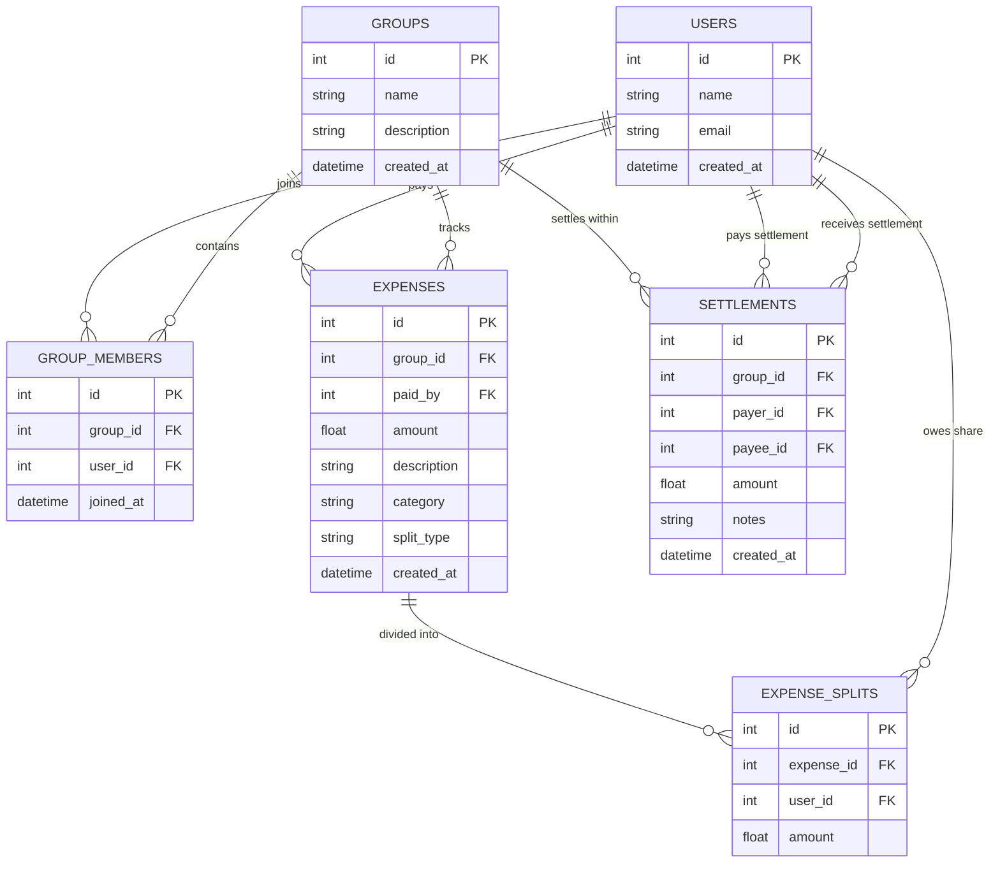

# Decentro SDE Intern Assignment — Expense Sharing Service

An end-to-end, high-performance **Expense Sharing Service** built with **FastAPI**, **SQLAlchemy**, **Pydantic v2**, and a modern, responsive **Web Dashboard UI**.

This project implements all core functional requirements, database models, balance calculations, bonus features, and product enhancements outlined in the **Decentro SDE Intern Technical Evaluation**.

---

## 🌟 Highlights & Features

- **Part 1 — User Management**: Create users and list all registered users (`POST /users`, `GET /users`).
- **Part 2 — Group Management**: Create groups, add users to groups, and list members (`POST /groups`, `POST /groups/{group_id}/members`, `GET /groups/{group_id}/members`).
- **Part 3 — Expense Management**: Add shared expenses with equal splits and custom unequal splits (`POST /expenses`, `GET /groups/{group_id}/expenses`). Supports penny-rounding financial precision.
- **Part 4 — Balance Calculation**: Structured pairwise debt format matching the exact assignment specification (`GET /balances`):
  ```json
  {
    "Rahul": {
      "owes": {
        "Mohit": 400
      }
    },
    "Ankit": {
      "owes": {
        "Mohit": 400
      }
    }
  }
  ```
- **⚡ Product Enhancement (Mandatory)**: 
  - **Smart Debt Simplification (Splitwise-style)**: Greedy Min-Cash-Flow graph algorithm to minimize transactions across the group to at most $N - 1$.
  - **Spending Analytics & Category Breakdown**: Real-time spending charts (Food, Travel, Lodging, Activities) and member financial scorecards.
  - **Search & Filters**: Filter expenses by keyword description and category.
  - **Data Export**: Export group expenses, settlements, and balances as CSV or JSON.
- **✨ Optional Bonus Features**:
  - **Balance Settlement**: Record payments (`POST /settlements`) that settle debts down to ₹0.
  - **Custom Unequal Splits**: Full support for exact splits (`splits: [{"user_id": 1, "amount": 500}, ...]`).
  - **Unit Test Suite**: 18 comprehensive tests with `pytest` covering validations, edge cases, algorithms, and models.
  - **Docker Setup**: Complete `Dockerfile` and `docker-compose.yml`.
  - **Postman Collection**: Pre-configured collection at `postman/Decentro_Expense_Sharing.postman_collection.json`.
- **🎨 Interactive Web Dashboard (Good UI)**:
  - Accessible directly at `http://localhost:8000/`.
  - Built with Tailwind CSS, Chart.js, glassmorphism, responsive tabs, modals, and a **1-Click Demo Seeder** to test the "Goa Trip" scenario immediately!

---

## 🏗️ Architecture Overview

The application follows clean architectural separation of concerns:

```
decentro-expense-sharing/
├── app/
│   ├── config.py             # App & Database configuration (Pydantic Settings)
│   ├── database.py           # SQLAlchemy engine, session maker, base
│   ├── models.py             # ORM models (User, Group, Member, Expense, Split, Settlement)
│   ├── schemas.py            # Pydantic v2 schemas and validation logic
│   ├── services/
│   │   ├── user_service.py       # User CRUD
│   │   ├── group_service.py      # Group & Membership logic
│   │   ├── expense_service.py    # Equal & exact split calculation, penny adjustment
│   │   ├── balance_service.py    # Pairwise balance netting & Min-Cash-Flow algorithm
│   │   ├── settlement_service.py # Settlement recording & history
│   │   └── analytics_service.py  # Metrics aggregation & CSV export
│   ├── routers/
│   │   ├── users.py              # /users endpoints
│   │   ├── groups.py             # /groups endpoints
│   │   ├── expenses.py           # /expenses endpoints
│   │   ├── balances.py           # /balances endpoints
│   │   ├── settlements.py        # /settlements endpoints
│   │   └── demo.py               # /api/demo/seed and /api/demo/reset
│   ├── static/js/app.js      # Reactive frontend logic, state & Chart.js rendering
│   └── templates/index.html  # Modern Tailwind CSS interactive dashboard
├── tests/                    # 18 Pytest unit tests
├── postman/                  # Postman collection
├── Dockerfile                # Production containerization
├── docker-compose.yml        # Docker compose orchestrator
├── requirements.txt          # Python dependencies
├── run.py                    # Server runner script
└── README.md
```

---

## 🗄️ Database Design (30% Evaluation Weight)

### Entity-Relationship Diagram



### Table Details & Rationale

1. **`users`**:
   - `id` (PK, autoincrement), `name` (VARCHAR 100, NOT NULL), `email` (VARCHAR 120, optional), `created_at` (TIMESTAMP).
2. **`groups`**:
   - `id` (PK, autoincrement), `name` (VARCHAR 100, NOT NULL), `description` (VARCHAR 255), `created_at` (TIMESTAMP).
3. **`group_members`**:
   - Association table linking users to groups.
   - Includes `UniqueConstraint("group_id", "user_id")` to prevent duplicate membership.
   - Cascading foreign keys (`ondelete="CASCADE"`).
4. **`expenses`**:
   - `id` (PK, autoincrement), `group_id` (FK to groups), `paid_by` (FK to users), `amount` (FLOAT, `CHECK (amount > 0)`), `description`, `category` (default 'General'), `split_type` ('EQUAL' or 'EXACT'), `created_at`.
5. **`expense_splits`**:
   - Stores each participant's individual financial obligation for the expense.
   - **Why a separate table?**
     - Guarantees historical immutability: even if new members join the group later, past expense allocations remain unchanged.
     - Supports unequal/custom splits (e.g., 500, 300, 200).
     - Allows subsets of group members to share an activity.
     - `UniqueConstraint("expense_id", "user_id")` ensures a user cannot be charged twice for the same expense.
6. **`settlements`**:
   - Records peer-to-peer balance settlements.
   - `payer_id` (FK), `payee_id` (FK), `amount` (`CHECK (amount > 0)`), `notes`, `created_at`.
   - `CHECK (payer_id != payee_id)` prevents self-settlement.

---

## 🧮 Balance Calculation & Logic (30% Evaluation Weight)

### 1. Direct Pairwise Debts
For every pair of users $A$ and $B$:
- Whenever $A$ pays upfront for an expense and $B$ is a participant owing share $S_B$: $B \rightarrow A \text{ debt} += S_B$.
- Whenever $B$ pays a settlement of $M$ to $A$: $B \rightarrow A \text{ debt} -= M$.
- Net debt between $A$ and $B$:
  $$\Delta = \text{Debt}(A \rightarrow B) - \text{Debt}(B \rightarrow A)$$
  - If $\Delta > 0.005$, user $A$ owes user $B$ the amount $\Delta$.
  - If $\Delta < -0.005$, user $B$ owes user $A$ the amount $-\Delta$.

### 2. Penny Adjustment (Rounding Precision)
When dividing an amount (e.g. ₹100 among 3 users), floating point division produces $33.3333...$. If each person pays $33.33$, $3 \times 33.33 = 99.99$ (loss of 1 cent).
Our implementation uses **integer cent division**:
- $100 \times 100 = 10000\text{ cents} \div 3 = 3333\text{ cents}$, remainder $1\text{ cent}$.
- The remainder cent is distributed to the first participant: $33.34 + 33.33 + 33.33 = 100.00$.

---

## ⚡ Product Enhancement: Smart Debt Simplification (10% Evaluation Weight)

### 1. Why this feature was chosen
In real-world group trips (such as Splitwise), direct pairwise balances often create unnecessary webs of transactions. For example, if Rahul owes Mohit ₹400 and Mohit owes Ankit ₹400, requiring Rahul to pay Mohit and then Mohit to pay Ankit creates two separate payments and friction.

### 2. What problem it solves
It simplifies the debt graph to the **minimum number of cash transfers** (at most $N - 1$ transactions for $N$ users) needed to make everyone's net balance zero.

### 3. Design decisions made
- **Algorithm**: Greedy Min-Cash-Flow matching.
  1. Calculate each user's net financial balance:
     $$\text{Net}(U) = \sum \text{Paid Upfront} + \sum \text{Settlements Paid} - \sum \text{Shares Consumed} - \sum \text{Settlements Received}$$
  2. Partition into debtors ($\text{Net} < 0$) and creditors ($\text{Net} > 0$).
  3. Greedily match the user with the maximum debt to the user with the maximum credit, settling $\min(|\text{Debt}|, \text{Credit})$.
  4. Update balances and repeat until all debts are cleared.
- Time Complexity: $O(N \log N)$ where $N$ is the number of group members.

### 4. Tradeoffs considered
- *Tradeoff*: Direct pairwise settlements preserve the exact historical context ("I am paying you back specifically for dinner"), while debt simplification may ask Rahul to pay Ankit directly even if Rahul and Ankit didn't interact on that specific bill.
- *Solution*: We provide **both views** side-by-side in the API and UI! Users can choose between Direct Pairwise settlements (`GET /balances`) and Smart Debt Simplification (`GET /groups/{id}/balances`).

---

## 🚀 Quick Setup & Running

### Option 1: Run Locally (Fastest)

1. **Clone the repository**:
   ```bash
   git clone <repo-url>
   cd decentro-expense-sharing
   ```

2. **Create and activate virtual environment** (optional but recommended):
   ```bash
   python -m venv venv
   # Windows:
   venv\Scripts\activate
   # Linux/macOS:
   source venv/bin/activate
   ```

3. **Install dependencies**:
   ```bash
   pip install -r requirements.txt
   ```

4. **Run the application**:
   ```bash
   python run.py
   # Or directly with uvicorn:
   uvicorn app.main:app --reload --port 8000
   ```

5. **Open in Browser**:
   - **Interactive Web Dashboard**: [http://localhost:8000](http://localhost:8000)
   - **Interactive Swagger API Docs**: [http://localhost:8000/docs](http://localhost:8000/docs)
   - **Alternative ReDoc**: [http://localhost:8000/redoc](http://localhost:8000/redoc)

---

### Option 2: Run with Docker & Docker Compose

```bash
docker-compose up --build
```
The service will start on `http://localhost:8000`.

---

## 🧪 Running Unit Tests

Run the full automated test suite (18 tests):
```bash
python -m pytest -v
```

Expected output:
```
tests/test_balances.py::test_benchmark_balance_calculation_exact_spec PASSED
tests/test_balances.py::test_bidirectional_expense_netting PASSED
tests/test_debt_simplification.py::test_debt_simplification_minimizes_transactions PASSED
tests/test_debt_simplification.py::test_group_analytics_and_csv_export PASSED
tests/test_expenses.py::test_add_expense_equal_split_benchmark PASSED
tests/test_expenses.py::test_add_expense_custom_unequal_splits PASSED
tests/test_expenses.py::test_add_expense_validation_amount_negative PASSED
tests/test_expenses.py::test_add_expense_validation_non_member_payer PASSED
tests/test_expenses.py::test_add_expense_custom_splits_mismatch PASSED
tests/test_expenses.py::test_list_group_expenses_and_filters PASSED
tests/test_groups.py::test_create_group PASSED
tests/test_groups.py::test_add_members_to_group PASSED
tests/test_groups.py::test_add_nonexistent_user_to_group PASSED
tests/test_settlements.py::test_balance_settlement_bonus_spec PASSED
tests/test_settlements.py::test_settlement_validations PASSED
tests/test_users.py::test_create_user_success PASSED
tests/test_users.py::test_create_user_blank_name_fails PASSED
tests/test_users.py::test_list_users PASSED
======================== 18 passed in 1.54s ========================
```

---

## 📖 API Documentation & Examples

### 1. User Management

#### `POST /users`
**Request**:
```json
{
  "name": "Mohit",
  "email": "mohit@example.com"
}
```
**Response** (`201 Created`):
```json
{
  "id": 1,
  "name": "Mohit",
  "email": "mohit@example.com",
  "created_at": "2026-10-15T19:20:00Z"
}
```

#### `GET /users`
Returns all registered users.

---

### 2. Group Management

#### `POST /groups`
**Request**:
```json
{
  "name": "Goa Trip",
  "description": "Weekend getaway with friends"
}
```
**Response** (`201 Created`):
```json
{
  "id": 1,
  "name": "Goa Trip",
  "description": "Weekend getaway with friends",
  "created_at": "2026-10-15T19:20:00Z"
}
```

#### `POST /groups/{group_id}/members`
**Request**:
```json
{
  "user_id": 2
}
```

#### `GET /groups/{group_id}/members`
Returns all members belonging to the specified group.

---

### 3. Expense Management

#### `POST /expenses` (Equal Split - Benchmark)
**Request**:
```json
{
  "group_id": 1,
  "paid_by": 1,
  "amount": 1200,
  "description": "Dinner",
  "category": "Food"
}
```
**Response** (`201 Created`):
```json
{
  "id": 1,
  "group_id": 1,
  "description": "Dinner",
  "amount": 1200.0,
  "paid_by": "Mohit",
  "paid_by_id": 1,
  "category": "Food",
  "split_type": "EQUAL",
  "splits": [
    { "user_id": 1, "user_name": "Mohit", "amount": 400.0 },
    { "user_id": 2, "user_name": "Rahul", "amount": 400.0 },
    { "user_id": 3, "user_name": "Ankit", "amount": 400.0 }
  ]
}
```

#### `POST /expenses` (Custom Unequal Split - Bonus)
```json
{
  "group_id": 1,
  "paid_by": 1,
  "amount": 1000,
  "description": "Buffet",
  "split_type": "EXACT",
  "splits": [
    { "user_id": 1, "amount": 500 },
    { "user_id": 2, "amount": 300 },
    { "user_id": 3, "amount": 200 }
  ]
}
```

#### `GET /groups/{group_id}/expenses`
Query parameters: `?category=Food&search=dinner`

---

### 4. Balance Calculation

#### `GET /balances` (Matches Page 8 Specification Exactly)
**Response**:
```json
{
  "Rahul": {
    "owes": {
      "Mohit": 400.0
    }
  },
  "Ankit": {
    "owes": {
      "Mohit": 400.0
    }
  }
}
```

---

### 5. Settlements (Bonus Feature)

#### `POST /settlements`
**Request**:
```json
{
  "group_id": 1,
  "payer_id": 2,
  "payee_id": 1,
  "amount": 400,
  "notes": "Paid via UPI"
}
```
*After this settlement, Rahul's debt to Mohit is reduced to 0.*

---

## 📌 Assumptions Made

1. **Member Participation in Equal Splits**: When an expense is recorded with equal split, it is divided equally among all current members of the group.
2. **Payer Role**: The user who paid upfront must be a registered member of the group.
3. **Payer Does Not Owe Themselves**: A payer's own consumption is factored into their net balance but is never listed as an active debt in `GET /balances`.
4. **Precision**: All financial amounts are rounded and stored to 2 decimal places (cents) with remainder distribution to avoid floating-point drift.

---

## 🔮 Future Improvements (With More Time)

1. **Authentication & Authorization**: Add JWT-based auth so users can only manage their own groups and record settlements on their own behalf.
2. **Push Notifications & WebSockets**: Real-time notifications when a friend records an expense or sends a settlement.
3. **Receipt OCR Scanning**: Allow users to take a photo of a restaurant receipt and automatically extract items and prices using an OCR pipeline.
4. **Multi-Currency Support**: Support live FX conversion for international trips.
